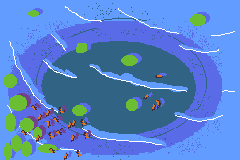

# Bouncers
An exercise to learn about functions and classes.

This is a simulator of shapes bouncing off the border of the game across both the x and y axis. The shapes will spawn when A is pressed at random speeds

Link to github pages gamesite:
https://crex424.github.io/bouncers/
